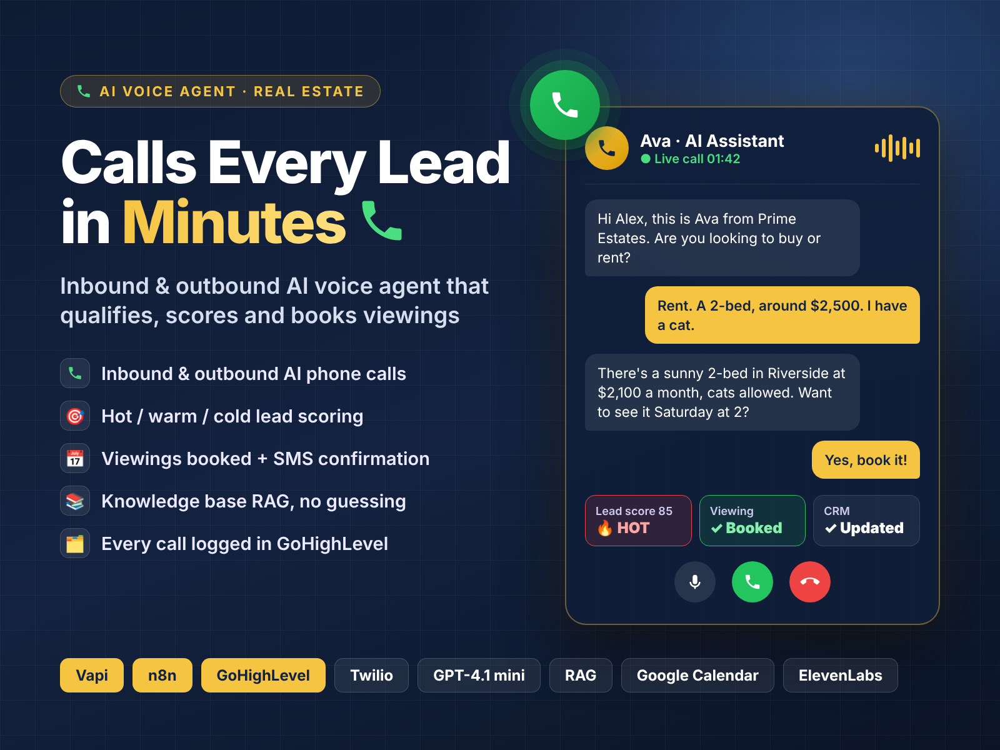
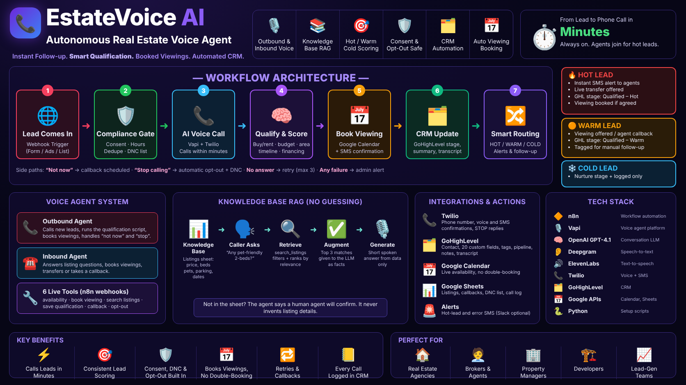
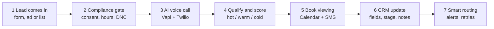
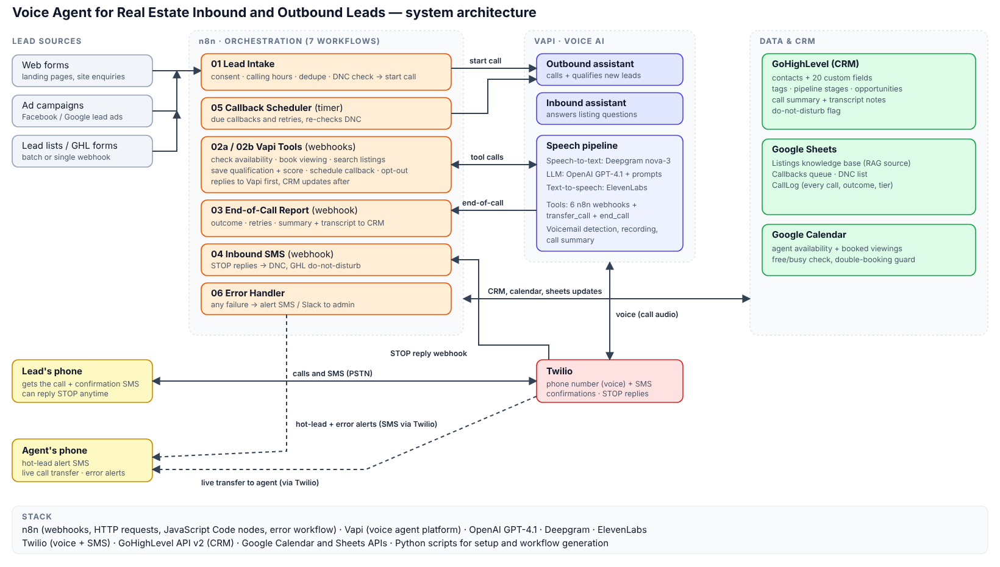
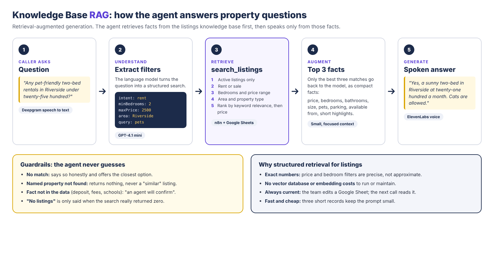
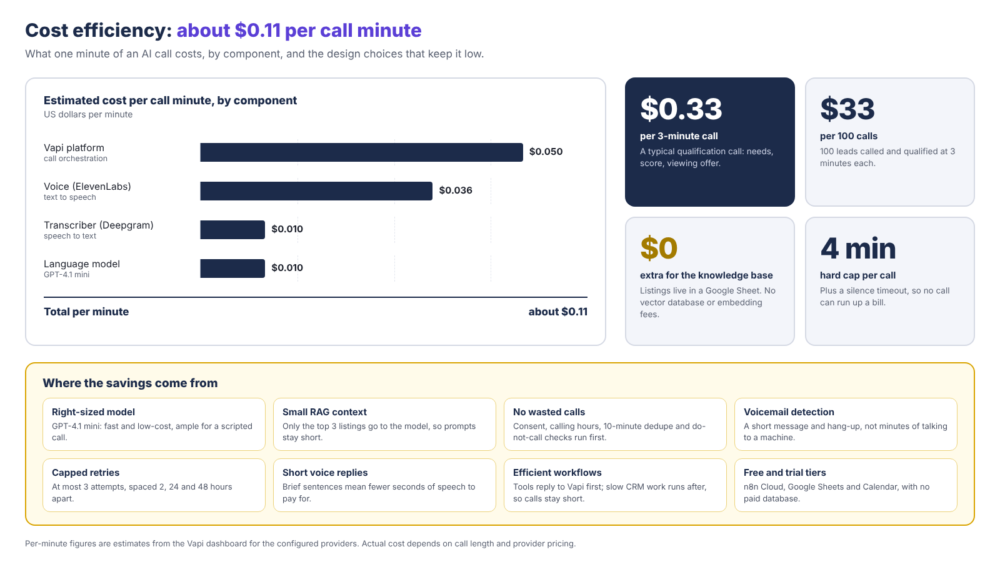

<div align="center">



# EstateVoice AI
### Voice Agent for Real Estate: Inbound and Outbound Leads

**An AI phone agent that calls every new lead within minutes, qualifies and scores them, books viewings, and keeps the CRM up to date. A second agent answers inbound calls about listings from a live knowledge base and never makes up facts.**

       

[Technical delivery report (PDF)](docs/Technical-Delivery-Report.pdf) · [Setup guide](docs/SETUP.md) · [Reference](docs/REFERENCE.md) · [Test plan](docs/TEST-PLAN.md)

</div>

> **Portfolio project.** Built to a real-estate client brief by **Muhammad Hassan, AI Automation Engineer & Full Stack Developer**. The example agency is "Prime Estates" and the voice persona is "Ava".

---

## Contents

1. [At a glance](#at-a-glance)
2. [The problem it solves](#the-problem-it-solves)
3. [Original plan vs what was delivered](#original-plan-vs-what-was-delivered)
4. [Architecture](#architecture)
5. [Technology stack](#technology-stack)
6. [The voice agent system](#the-voice-agent-system)
7. [Knowledge base RAG](#knowledge-base-rag)
8. [n8n workflows](#n8n-workflows)
9. [GoHighLevel CRM](#gohighlevel-crm)
10. [Lead scoring](#lead-scoring)
11. [Cost efficiency](#cost-efficiency)
12. [Compliance and safety](#compliance-and-safety)
13. [Testing and verification](#testing-and-verification)
14. [Repository layout](#repository-layout)
15. [Getting started](#getting-started)
16. [Security](#security)
17. [Author](#author) · [License](#license)

---

## At a glance

When someone enquires about a property, the agent calls them within minutes, asks a few friendly questions, works out how serious they are, books a viewing and writes everything into the CRM. When people call in, it answers questions about listings from a live knowledge base.



| 7 | 6 | 20 | 46 / 46 | ~2.1 s | ~$0.11 |
|:--:|:--:|:--:|:--:|:--:|:--:|
| n8n workflows | live voice tools | CRM custom fields | end-to-end checks passed | estimated reply latency | estimated cost per call minute |

Latency and cost are Vapi dashboard estimates for the configured providers.

### The seven-step flow every lead follows



Side paths: "not now" schedules a callback, "stop calling" opts the person out everywhere, no answer retries (max 3), any failure alerts the admin.

## The problem it solves

Real estate agencies lose business in the gap between an enquiry and the first conversation.

- **Slow speed-to-lead.** Leads wait hours for a first call and move on to a competitor.
- **Repetitive qualification.** Agents ask the same six questions on every lead: buy or rent, budget, area, bedrooms, timeline, financing.
- **Inconsistent answers.** Callers get different or wrong property details depending on who picks up.
- **Manual CRM entry.** Notes are typed late or incomplete, so the pipeline cannot be trusted.
- **Missed hot leads.** Serious buyers wait in the same queue as casual browsers.
- **Scheduling friction.** Booking a viewing takes many messages, and double-bookings happen.
- **Compliance risk and cost.** Calling outside allowed hours, after a "stop", or twice in a row wastes money and creates risk.

## Original plan vs what was delivered

The project followed the original brief feature for feature.

| Planned feature | Delivered as |
|---|---|
| Outbound calling within minutes | Vapi outbound assistant, started by n8n workflow 01 through a webhook |
| Lead qualification | `save_qualification` tool captures and cleans every answer |
| Hot, warm and cold scoring | Weighted scoring: hot at 70 or more, warm at 40 or more |
| Viewing booking and SMS | `check_availability` and `book_viewing` with Google Calendar and Twilio SMS |
| CRM automation | GoHighLevel fields, stage, tags, notes, summary and transcript |
| Hot-lead alerts and transfer | Alert SMS plus an optional live-transfer tool |
| "Not now" and "stop calling" | `schedule_callback`, `opt_out`, callback scheduler and STOP-reply workflow |
| Inbound agent with a knowledge base | Inbound assistant with `search_listings` over the Listings sheet (RAG) |
| Documented n8n workflows | 7 exported workflows, endpoints file, credentials template, validator |
| Scripts, prompts and handover | System prompts, call script, setup guide, test plan, compliance notes, handover guide |

## Architecture



Lead sources (web forms, ad campaigns, lead lists) feed **n8n**, which orchestrates seven workflows. **Vapi** runs the voice assistants and calls n8n webhooks as tools. **Twilio** carries the calls and SMS. **Google Sheets**, **Google Calendar** and **GoHighLevel** hold the knowledge base, schedule and CRM data.

## Technology stack

| Tool | Role | What it is used for |
|---|---|---|
| **Vapi** | Voice AI platform | Outbound and inbound assistants, tool calling, recording, voicemail detection, end-of-call summaries |
| **OpenAI GPT-4.1 mini** | Language model | Understands the caller, turns questions into searches, follows the script, answers from retrieved facts |
| **Deepgram Nova 3** | Speech to text | Fast, accurate transcription of the caller |
| **ElevenLabs** | Text to speech | Natural, friendly voice |
| **Twilio** | Telephony and SMS | Phone number, viewing confirmations, STOP replies |
| **n8n** | Workflow automation | Seven workflows: intake, tool webhooks, end-of-call report, inbound SMS, callbacks, error handling |
| **GoHighLevel** | CRM | Contacts, 20 custom fields, tags, pipeline stages, opportunities, notes, do-not-disturb |
| **Google Sheets** | Knowledge base and data | Listings (RAG), callbacks queue, do-not-call list, call log |
| **Google Calendar** | Scheduling | Live availability, viewing events, double-booking protection |
| **Python and Node.js** | Tooling | Generate workflows, provision Vapi, run a mock-service test harness |

## The voice agent system

**Two assistants**

- **Outbound (Ava)** calls new leads, runs the qualification script, books viewings, handles "not now" and "stop calling", and detects voicemail.
- **Inbound (Ava)** answers listing questions through the knowledge base, books viewings, takes callbacks and hands over to an agent during office hours.

**Six live tools**

| Tool | What the agent does with it | Workflow |
|---|---|---|
| `check_availability` | Looks up open viewing slots, never invents times | 02a |
| `book_viewing` | Creates the calendar event and sends the SMS confirmation | 02a |
| `search_listings` | The RAG retriever: active listings by area, price, bedrooms and type | 02a |
| `save_qualification` | Saves answers, scores the lead, writes to the CRM | 02b |
| `schedule_callback` | Schedules a follow-up at the time the lead asks for | 02b |
| `opt_out` | Adds the number to the do-not-call list and marks the CRM contact | 02b |

**What makes it dependable**

- **Grounded answers.** Property facts come only from the knowledge base. If something is missing, the agent says an agent will confirm.
- **Natural voice style.** Short sentences, one idea at a time, at most two properties per reply, prices said the way people say them.
- **Honest about being AI.** It introduces itself as a virtual assistant and mentions recording at the start.
- **Prepared for real calls.** Rules cover callbacks, opt-out, requests for a human, other cities, unclear speech, silence, rude callers and sold properties.
- **Consistent.** Low model temperature, a silence timeout and a maximum call length keep every call predictable.

## Knowledge base RAG

Before the agent answers a property question, it looks the answer up, takes the best three matches and speaks only from those facts. This is retrieval-augmented generation, and it is why the agent does not invent prices or features.



The retriever is **structured retrieval**, not a vector database. `search_listings` reads the Listings sheet, keeps active listings, filters by rent or sale, bedrooms, price range, area and property type, ranks by keyword relevance then price, and returns the top 3 as compact records.

**Guardrails: the agent never guesses**

- No match: it says so honestly and offers the closest option.
- A named property that is not found returns nothing, never a "similar" listing.
- A fact not in the data (deposit, fees, schools) becomes "an agent will confirm".
- "No listings" is only said when the search really returned zero.

**Why structured retrieval:** exact price and bedroom filters, no vector database or embedding cost, always current (edit the sheet and the next call reads it), and small prompts.

## n8n workflows

| # | Workflow | Purpose |
|---|---|---|
| 01 | Lead intake and outbound call | Consent, calling hours, 10-minute dedupe, DNC check, then start the call |
| 02a | Vapi tools: calendar and listings | `check_availability`, `book_viewing`, `search_listings` |
| 02b | Vapi tools: leads and compliance | `save_qualification`, `schedule_callback`, `opt_out` |
| 03 | End-of-call report | Outcome, retries, summary and transcript to the CRM, hot-lead alerts |
| 04 | Inbound SMS opt-out | STOP replies update the DNC list and GoHighLevel do-not-disturb |
| 05 | Callback scheduler | Every 5 minutes: due callbacks and retries, DNC re-check |
| 06 | Error handler | Any failure alerts the admin by SMS or Slack |

Tool workflows reply to Vapi first and do slower CRM work afterwards, so the caller never waits.

## GoHighLevel CRM

Pipeline **AI Lead Follow-up**: New Lead, Contacted - No Answer, Qualified - Hot, Qualified - Warm, Nurture - Cold, Viewing Booked, Do Not Contact. Each lead gets 20 custom `ai_*` fields, tags, an opportunity, a call summary note and the transcript.

| Lead tier | What happens |
|---|---|
| **Hot** | Instant SMS alert to agents, live transfer offered, stage Qualified - Hot, viewing booked if agreed |
| **Warm** | Viewing offered or agent callback, stage Qualified - Warm, tagged for follow-up |
| **Cold** | Nurture stage and logged only |

## Lead scoring

Total 0 to 100. **Hot at 70 or more, warm at 40 or more**, otherwise cold.

| Signal | Points |
|---|---|
| Timeline | up to 35 (immediately 35, within a month 30, 1 to 3 months 20) |
| Financing | up to 25 (cash or pre-approved 25, ready to apply 22) |
| Specificity | budget 8, area 7, bedrooms 5 |
| Engagement | viewing interest up to 15, viewing booked 15, wants an agent 5 |

All weights live in `config.json`.

## Cost efficiency

About **$0.11 per call minute**, roughly **$0.33 for a typical 3-minute call**.



Savings come from a right-sized model, a small RAG context (top 3 listings only), checks that run before dialling (consent, hours, dedupe, DNC), voicemail detection, capped retries (3 attempts at 2, 24 and 48 hours), short voice replies, a 4-minute call cap with a silence timeout, and free or trial tiers for n8n, Sheets and Calendar. The knowledge base adds no vector database or embedding fees.

## Compliance and safety

- Consent flag required before any outbound call.
- Calls only 09:00 to 20:00, Monday to Saturday, in the lead's timezone.
- 10-minute dedupe so nobody is called twice in a row.
- Do-not-call list checked at intake and again before every retry or callback.
- "Stop calling" on the call or "STOP" by SMS opts the person out everywhere.
- The agent says it is a virtual assistant and that the call may be recorded.

See [docs/COMPLIANCE.md](docs/COMPLIANCE.md). This is not legal advice; check the rules for your country and state.

## Testing and verification

- **Static validator** (`tests/validate_workflows.py`) checks every workflow.
- **46 / 46 end-to-end checks** pass: real n8n (2.35.7) runs the workflows against mock GoHighLevel, Vapi, Twilio and Google servers (`tests/e2e/`).
- **Live voice testing** was done on the Vapi agent with a demo set of 12 New York listings embedded in the prompt.
- **Not connected in this repository:** live Twilio, GoHighLevel, Google writes and an outbound call. Run section B of [docs/TEST-PLAN.md](docs/TEST-PLAN.md) before launch.

## Repository layout

```
.
├── workflows/          7 n8n workflows (JSON), credentials template, ENDPOINTS.md
├── prompts/            outbound and inbound system prompts, call script
├── vapi/               tool and assistant definitions as sent to Vapi
├── knowledge-base/     sample listings CSV for the Listings tab
├── samples/            sample leads with expected outcomes
├── tools/              generators and setup scripts (build_workflows, configure_vapi, configure_ghl)
├── tests/              static validator and local end-to-end harness
├── docs/               setup, reference, test plan, compliance, handover, PDF report, images
├── config.example.json copy to config.json and fill in your own values
└── voice-agent-sheet.xlsx  Google Sheet template (Listings, Callbacks, DNC, CallLog)
```

## Getting started

1. Copy `config.example.json` to `config.json` and fill in your values (it is git-ignored).
2. Follow [docs/SETUP.md](docs/SETUP.md): create the Google Sheet from `voice-agent-sheet.xlsx`, then import the workflows into n8n.
3. Generate and import the workflows, then provision Vapi:
   ```bash
   python tools/build_workflows.py
   python tools/configure_vapi.py
   python tools/configure_ghl.py      # optional, creates the GoHighLevel pipeline and fields
   ```
4. In the Vapi dashboard, publish the assistants after each change, then test with a web call.
5. Edit `config.json`, never the generated JSON.

## Security

No keys, tokens or account IDs are committed. `config.json` is git-ignored, and webhook secrets and IDs in the JSON files are placeholders (`REPLACE_WITH_...`, `YOUR_...`).

## Author

**Muhammad Hassan**, AI Automation Engineer & Full Stack Developer.
Voice agents, n8n automation, GoHighLevel and Shopify. Top Rated on Upwork.

## License

MIT. See [LICENSE](LICENSE).
